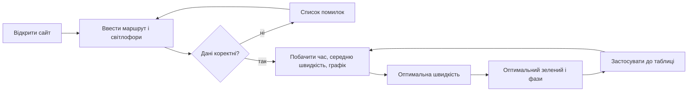

# MVP і межі першого релізу

## Розкладка за MoSCoW

| Категорія | Вимоги |
| --- | --- |
| Must | FR-01, FR-02, FR-03, FR-04, FR-05, FR-06, FR-07, FR-08, FR-09, FR-12, FR-13 |
| Should | FR-10, FR-11, FR-14, FR-16 |
| Could | FR-15 |
| Won't (у v1.0.0) | зворотний напрямок руху; збереження й експорт проєкту; зміна довжини циклу під час оптимізації; кілька маршрутів; модель розгону й гальмування; поперечні потоки |

## Межа першого релізу (v1.0.0)

До релізу входять усі Must, Should і Could. Будь-що з Won't переходить у наступні версії ([backlog.md](backlog.md)).

## Шлях користувача (MVP)

