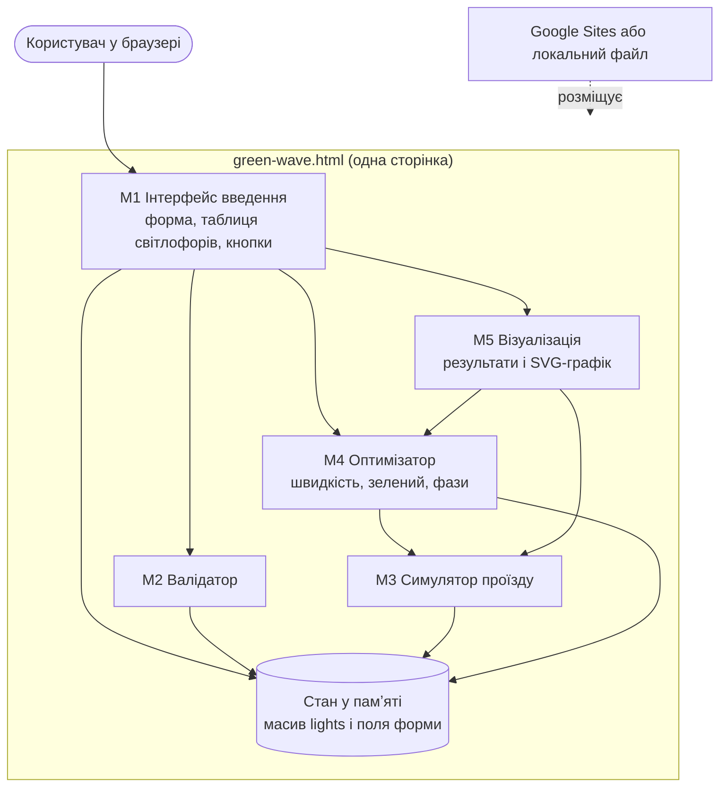

# Архітектура

## Архітектурний стиль

**Клієнтський (client-side) моноліт із шаруватою організацією** в одному HTML-файлі: шар інтерфейсу → шар перевірки → шар розрахунку й оптимізації → шар візуалізації. Сервера й бази даних немає.

### Обґрунтування вибору

| Стиль | Підходить? | Чому |
| --- | --- | --- |
| Клієнтський моноліт (обрано) | так | розрахунок легкий (десятки мілісекунд), даних для збереження немає, потрібна простота розгортання на Google Sites і робота офлайн |
| Клієнт-серверний | ні | сервер додав би хостинг, безпеку й затримку, але не дав би користі: усі дані локальні |
| Багаторівневий з окремою БД | ні | немає даних для довгого зберігання (див. [data-model.md](../3-implementation/data-model.md)) |
| Мікросервісний | ні | для 5 невеликих модулів і 2 розробників це надмірна складність |

Рішення зафіксовано в [ADR 0001](adr/0001-client-side-single-file.md).

## Діаграма компонентів

## Масштабування й розширення

| Напрям | Як розширюється |
| --- | --- |
| Більше світлофорів | складність розрахунку лінійна за кількістю світлофорів і кроків швидкості (1990 кроків × 20 світлофорів ≈ 77 мс у вимірі, див. [test-report.md](../4-quality/test-report.md)) |
| Зворотний напрямок, кілька маршрутів | додати в модель поле «напрямок» і другу траєкторію в M3 та M5, інтерфейс M1 не змінюється принципово |
| Збереження проєктів | додати `localStorage` у M1 або сервер із REST API, модуль M3-M4 залишиться незмінним |
| Підтримка й тестування | розділити файл на ES-модулі за модулями M1-M5 і прибрати прямі звернення розрахункових функцій до DOM (див. зауваження RV-05 у [review-report.md](../4-quality/review-report.md)) |
