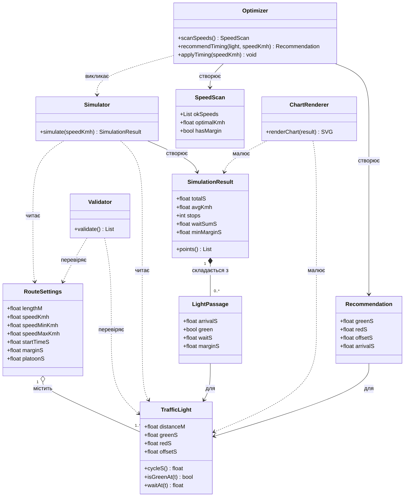

# Діаграма класів предметної області

Прототип написано на JavaScript у функціональному стилі. Діаграма описує предметну модель: класи відповідають структурам даних і функціям прототипу (див. [modules.md](modules.md)).

