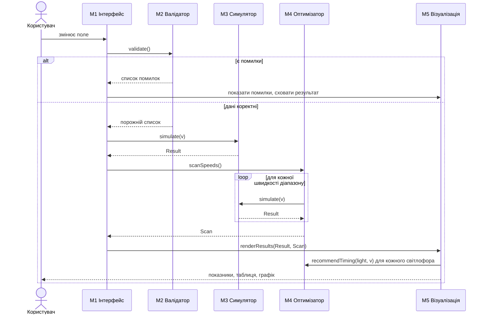
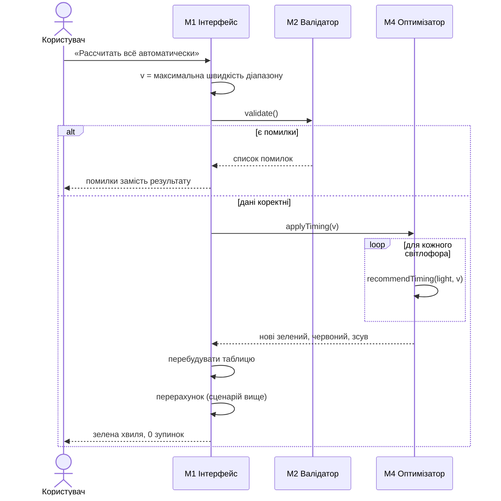

# План інтеграції модулів

## Порядок інтеграції

1. **M2 Валідатор** з полями форми (M1): перевірка, що помилки блокують результат.
2. **M3 Симулятор** після M2: перевірка на еталонних прикладах.
3. **M4 Оптимізатор** поверх M3: перевірка, що `scanSpeeds()` і `applyTiming()` дають нуль зупинок.
4. **M5 Візуалізація**: підключення результатів M3 і M4.
5. **Кнопки M1** («Оптимальная скорость», «Оптимальный зелёный и фазы», «Рассчитать всё автоматически») як останній крок, бо вони обʼєднують усі модулі.

## Взаємодія в головних сценаріях

### Перерахунок при зміні поля

### Автоматичний режим

## Стики модулів і можливі проблеми

| Стик | Ризик | Як перевіряється |
| --- | --- | --- |
| ST-01 M1-M2 | порожнє поле розцінюється як 0 і дає хибну помилку або проходить | TC-31, TC-38 |
| ST-02 M2-M3 | некоректні дані доходять до симулятора | TC-12, TC-38 |
| ST-03 M4-M3 | похибка округлення на межі зеленого (прибуття рівно в момент зміни сигналу) | TC-03, TC-04 |
| ST-04 M4-M1 | після `applyTiming` таблиця не відображає нові значення | TC-32, TC-33 |
| ST-05 M5-M3/M4 | нумерація світлофорів у результатах не збігається з таблицею введення, якщо світлофори введено не за порядком | BUG-003 |
| ST-06 M3/M4-стан | розрахункові функції читають поля форми напряму, тому їх неможливо викликати окремо від сторінки | RV-05 у review-report.md |
