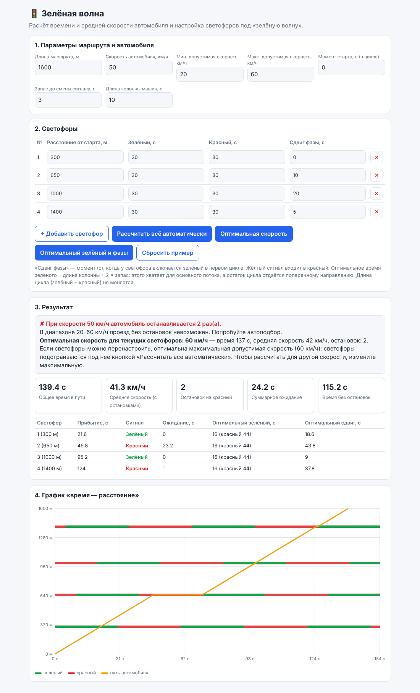
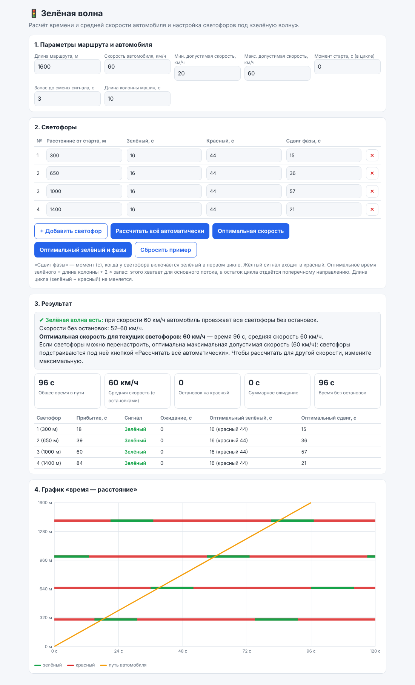
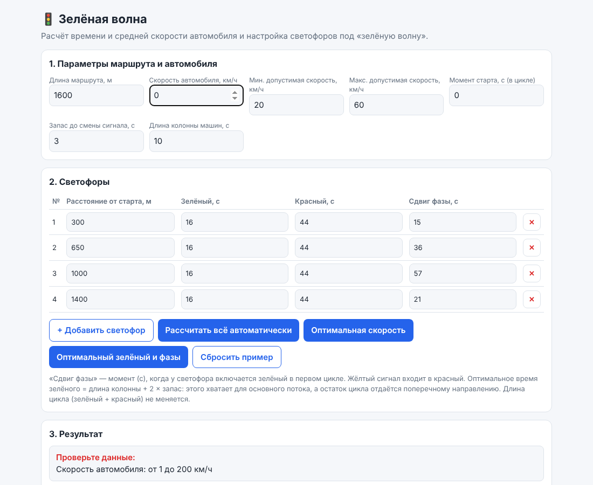
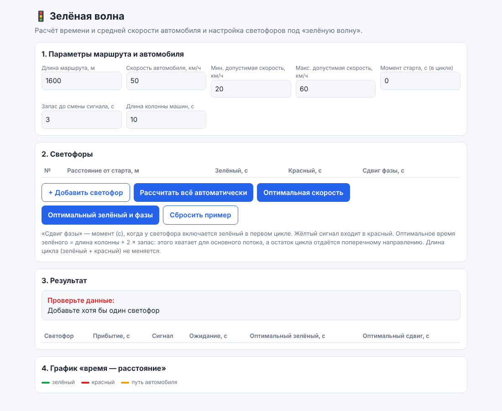
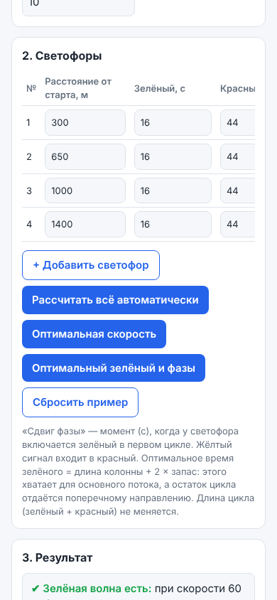

# Прототип

Прототип є робочою версією продукту: один файл [green-wave.html](green-wave.html). Відкривається подвійним кліком у будь-якому сучасному браузері, інтернет не потрібен.

Сайт: `посилання на Google Sites`.

## Ключові екрани

| Екран | Зображення |
| --- | --- |
| Головний екран із типовим прикладом |  |
| Результат після «Рассчитать всё автоматически» (стан успіху) |  |
| Помилка введення (швидкість 0) |  |
| Порожній стан (світлофорів немає) |  |
| Мобільна версія |  |

## Головний шлях

Відкрити сторінку → ввести маршрут і світлофори (або використати приклад) → побачити час, середню швидкість і графік → натиснути «Рассчитать всё автоматически» → отримати зелену хвилю з 0 зупинок.

## Помилки і порожні стани

- Некоректне значення поля: замість результату виводиться перелік помилок (екран 3).
- Світлофорів немає: повідомлення «Добавьте хотя бы один светофор» (екран 4).
- Швидкостей без зупинок немає: повідомлення з найкращою середньою швидкістю і порадою використати автопідбір.
