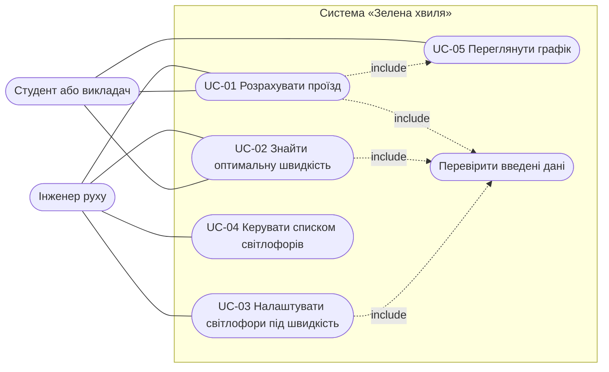

# Варіанти використання

## Діаграма

Mermaid не має окремого типу діаграми варіантів використання, тому застосовано схему `flowchart` у нотації акторів і прецедентів.

## UC-01. Розрахувати проїзд

| Поле | Опис |
| --- | --- |
| Актори | Інженер руху, студент |
| Передумови | сторінка відкрита, у таблиці є хоча б один світлофор |
| Основний потік | 1. Користувач вводить довжину маршруту, швидкість, момент старту. 2. Задає параметри світлофорів. 3. Система перевіряє дані. 4. Система розраховує час і середню швидкість, кількість зупинок, очікування. 5. Система показує таблицю по світлофорах і графік |
| Альтернативи | 3а. Дані некоректні: система показує список помилок, результат і графік приховано; користувач виправляє поля і повертається до кроку 3. 4а. Світлофор розташований далі за кінець маршруту: система його ігнорує |
| Результат | користувач бачить час, середню швидкість і зупинки |

## UC-02. Знайти оптимальну швидкість

| Поле | Опис |
| --- | --- |
| Актори | Інженер руху, студент |
| Передумови | дані коректні, задано діапазон швидкостей і запас |
| Основний потік | 1. Система перебирає швидкості діапазону з кроком 0,1 км/год. 2. Показує інтервали швидкостей без зупинок. 3. Показує оптимальну швидкість із часом і середньою швидкістю. 4. Користувач натискає «Оптимальная скорость», і швидкість підставляється в розрахунок |
| Альтернативи | 2а. Швидкості без зупинок немає: система показує повідомлення і швидкість із найбільшою середньою швидкістю. 3а. Немає швидкості із заданим запасом: береться найвища швидкість без зупинок, у повідомленні зазначено, що запас менший за заданий |
| Результат | у полі швидкості стоїть оптимальне значення |

## UC-03. Налаштувати світлофори під швидкість

| Поле | Опис |
| --- | --- |
| Актори | Інженер руху |
| Передумови | дані коректні, відома швидкість проїзду |
| Основний потік | 1. Система для кожного світлофора показує оптимальний зелений і зсув фази. 2. Користувач натискає «Оптимальный зелёный и фазы». 3. Система записує нові значення в таблицю (довжина циклу не змінюється). 4. Система перераховує результат: зупинок 0 |
| Альтернативи | 2а. Користувач натискає «Рассчитать всё автоматически»: система ставить максимальну швидкість і виконує кроки 3-4. 1а. Цикл закороткий для колони: зелений обмежується значенням «цикл − 3 с» |
| Результат | світлофори налаштовані на зелену хвилю |
