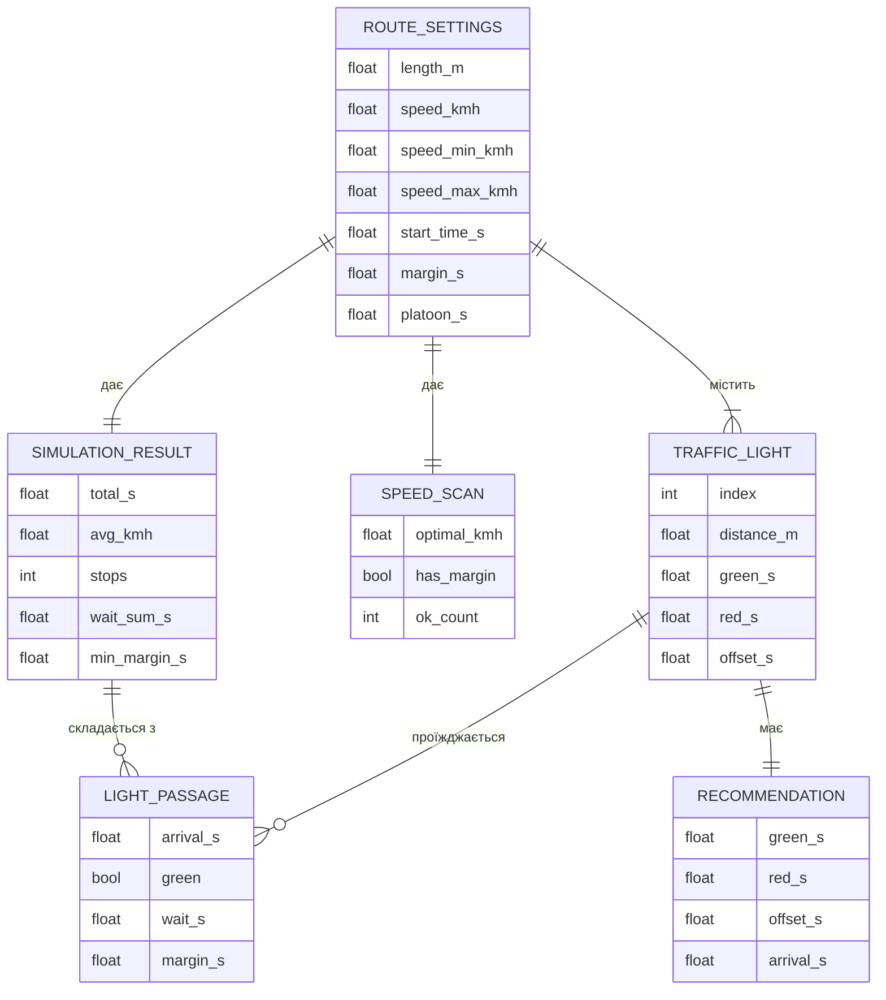

# Модель даних

Постійної бази даних немає. Усі дані існують у памʼяті сторінки доти, доки вона відкрита (ADR 0001). Модель описує структури даних, якими оперує застосунок.

## ER-діаграма

## Словник даних

| Сутність | Поле | Тип | Обовʼязкове | Приклад |
| --- | --- | --- | --- | --- |
| RouteSettings | length_m | число, м | так | 1600 |
| RouteSettings | speed_kmh | число, км/год | так | 50 |
| RouteSettings | speed_min_kmh | число, км/год | так | 20 |
| RouteSettings | speed_max_kmh | число, км/год | так | 60 |
| RouteSettings | start_time_s | число, с | ні (за замовчуванням 0) | 0 |
| RouteSettings | margin_s | число, с | ні (за замовчуванням 3) | 3 |
| RouteSettings | platoon_s | число, с | ні (за замовчуванням 10) | 10 |
| TrafficLight | distance_m | число, м | так | 650 |
| TrafficLight | green_s | число, с | так | 30 |
| TrafficLight | red_s | число, с | так | 30 |
| TrafficLight | offset_s | число, с | так | 10 |
| SimulationResult | total_s, avg_kmh, stops, wait_sum_s, min_margin_s | обчислювані | так | 110; 32,7; 1; 10; 0 |
| LightPassage | arrival_s, green, wait_s, margin_s | обчислювані | так | 50; false; 10; 0 |
| SpeedScan | optimal_kmh, has_margin, ok_count | обчислювані | так | 28,5; true; 100 |
| Recommendation | green_s, red_s, offset_s, arrival_s | обчислювані | так | 16; 44; 47; 50 |

## Де й як зберігаються дані

- **Параметри маршруту** — значення полів форми на сторінці.
- **Світлофори** — масив обʼєктів `lights` у памʼяті сторінки.
- **Результати** (SimulationResult, LightPassage, SpeedScan, Recommendation) — не зберігаються, перераховуються при кожній зміні й одразу відображаються.
- Після закриття або оновлення сторінки дані втрачаються. Збереження й експорт — у беклозі (елемент 15).

## Зовнішні сервіси

Немає. Застосунок не надсилає запитів у мережу (перевірено TC-43).
