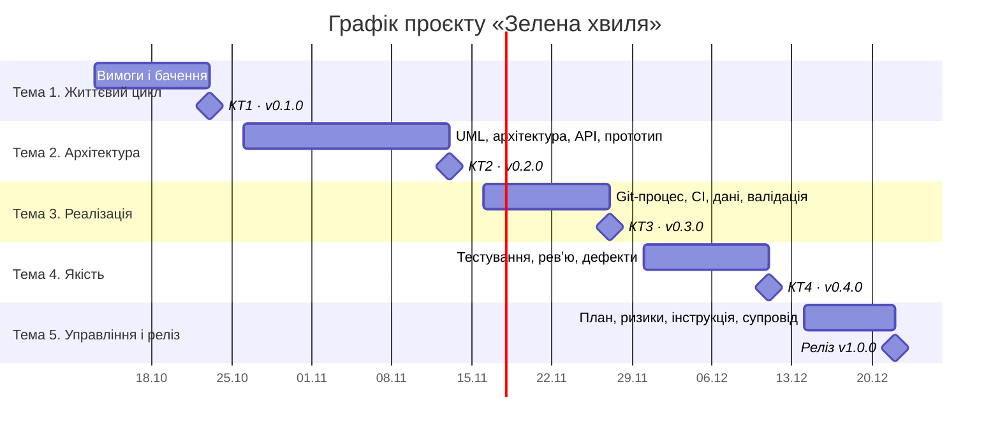

# План реалізації проєкту

Оцінки й дати орієнтовні, команда уточнює їх за розкладом курсу.

## Декомпозиція робіт (WBS)

```text
1 Продукт «Зелена хвиля»
├── 1.1 Вимоги і бачення (vision, process, SRS, MVP, трасування)
├── 1.2 Проєктування (UML, архітектура, модулі, API, ADR)
├── 1.3 Реалізація прототипу (ядро розрахунку, інтерфейс, графік)
├── 1.4 Валідація й оптимізація (правила, оптимальна швидкість і зелений)
├── 1.5 Тестування (план, кейси, автоматизація, звіт)
├── 1.6 Ревʼю і дефекти
└── 1.7 Управління і реліз (план, ризики, release-plan, user-guide, support)
```

## Оцінка трудомісткості (PERT, години)

Формула: `E = (O + 4M + P) / 6`, де O — оптимістична, M — найімовірніша, P — песимістична оцінка.

| WBS | Робота | O | M | P | E |
| --- | --- | --- | --- | --- | --- |
| 1.1 | Вимоги і бачення | 6 | 10 | 16 | 10,3 |
| 1.2 | Проєктування | 6 | 9 | 14 | 9,3 |
| 1.3 | Реалізація прототипу | 12 | 18 | 30 | 19,0 |
| 1.4 | Валідація й оптимізація | 4 | 6 | 10 | 6,3 |
| 1.5 | Тестування | 8 | 12 | 20 | 12,7 |
| 1.6 | Ревʼю і дефекти | 3 | 5 | 8 | 5,2 |
| 1.7 | Управління і реліз | 6 | 9 | 14 | 9,3 |
| | Разом | | | | 72,2 |

Приблизно 72 години, тобто близько 36 годин на людину при команді з двох осіб. Спринт 1 (36 SP) охоплює роботи 1.3 і 1.4 та частину 1.1 ([sprint-plan.md](../1-lifecycle/sprint-plan.md)).

## Графік і віхи


