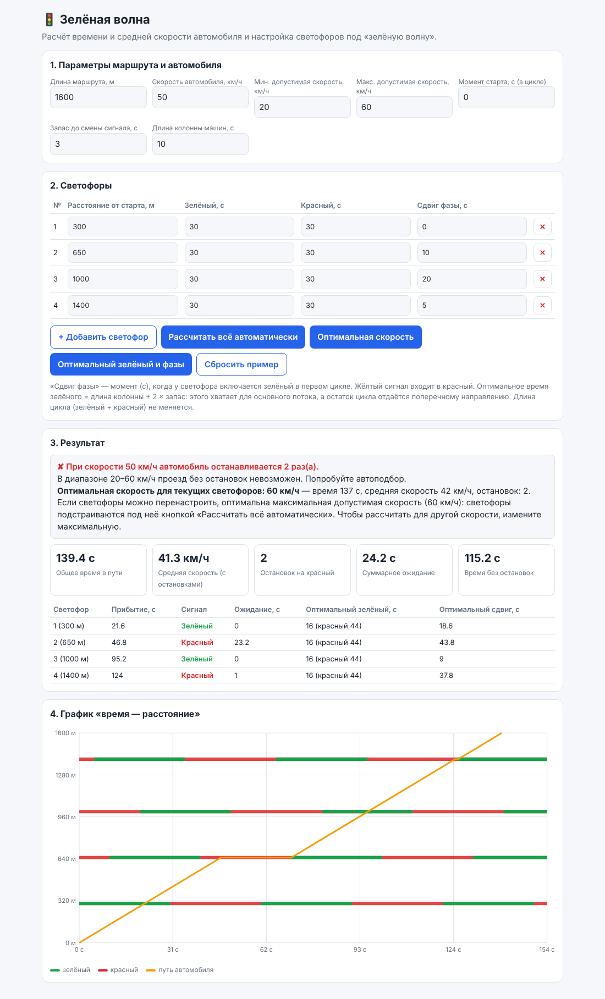
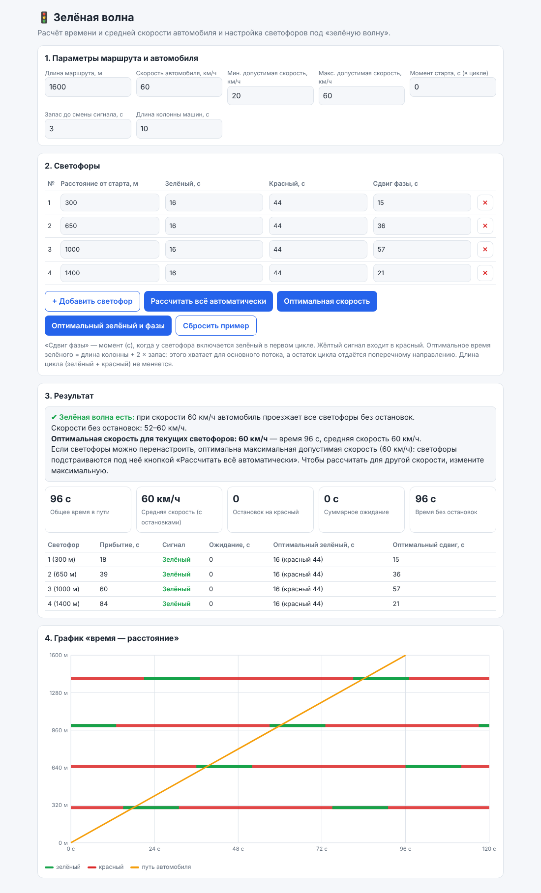
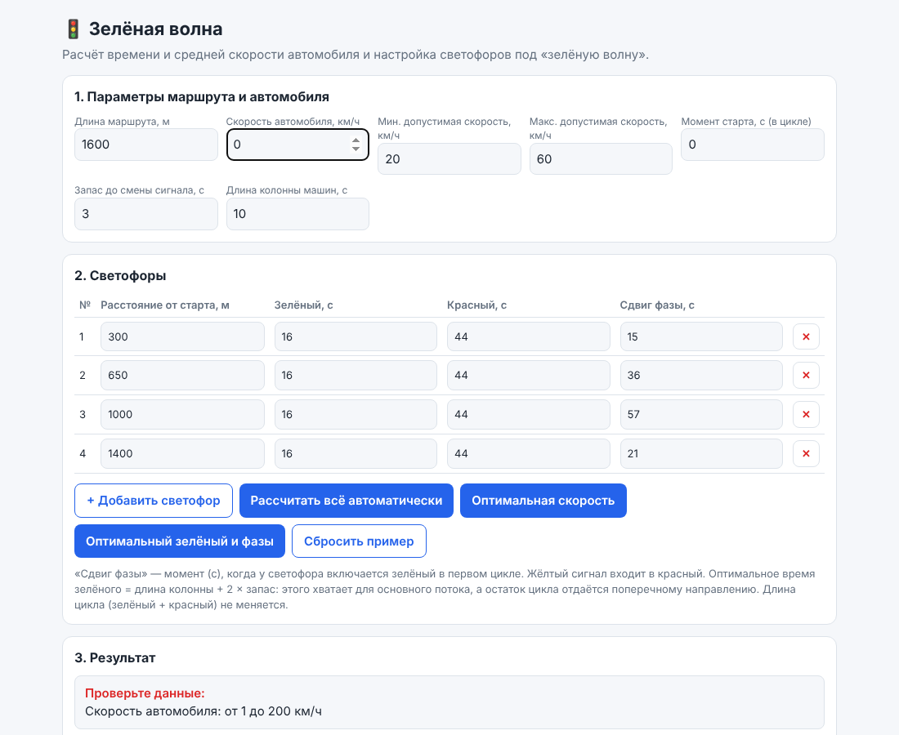
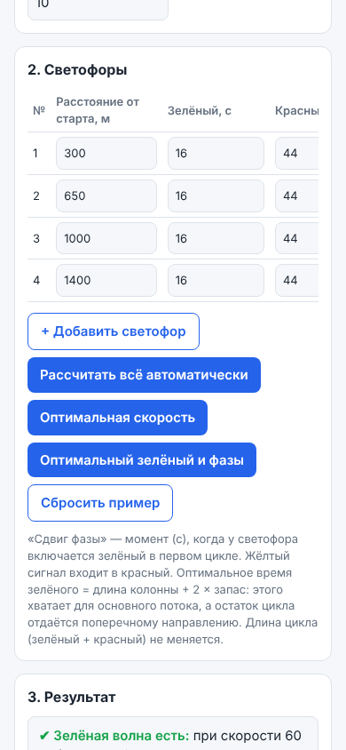

# Інструкція користувача

## Для чого сайт

«Зелена хвиля» рахує, за який час і з якою середньою швидкістю автомобіль проїде маршрут зі світлофорами, знаходить оптимальну швидкість і підказує, який зелений і зсув фази поставити, щоб автомобіль не зупинявся.

## Початок роботи

Відкрийте сайт за посиланням `посилання на Google Sites` або файл `green-wave.html` у браузері. Інсталяція й реєстрація не потрібні. На сторінці вже є приклад із чотирма світлофорами.

## Сценарій 1. Розрахувати проїзд (UC-01)

1. У блоці «Параметры маршрута и автомобиля» введіть довжину маршруту, швидкість автомобіля та момент старту.
2. У блоці «Светофоры» для кожного світлофора вкажіть відстань від старту, тривалість зеленого й червоного, зсув фази. Кнопка «+ Добавить светофор» додає рядок, кнопка ✕ видаляє.
3. Результат оновлюється одразу після зміни поля. У блоці «Результат» видно час у дорозі, середню швидкість, кількість зупинок і сумарне очікування, а в таблиці — час прибуття, сигнал і очікування для кожного світлофора.

## Сценарій 2. Знайти оптимальну швидкість (UC-02)

1. Задайте допустимий діапазон швидкостей і «Запас до смены сигнала».
2. Прочитайте в блоці «Результат» інтервали швидкостей без зупинок і оптимальну швидкість.
3. Натисніть «Оптимальная скорость», щоб підставити її в поле швидкості.

## Сценарій 3. Налаштувати світлофори (UC-03)

1. Поставте потрібну швидкість (або натисніть «Оптимальная скорость»).
2. У таблиці результатів подивіться колонки «Оптимальный зелёный» і «Оптимальный сдвиг».
3. Натисніть «Оптимальный зелёный и фазы», щоб записати значення в таблицю світлофорів. Довжина циклу (зелений + червоний) не змінюється.
4. Або натисніть «Рассчитать всё автоматически»: сайт підставить максимальну швидкість діапазону і налаштує всі світлофори.

## Як читати графік

По горизонталі час у секундах, по вертикалі відстань у метрах. Кожна горизонтальна смуга відповідає світлофору: зелені відрізки — коли горить зелений, червоні — коли червоний. Помаранчева лінія — шлях автомобіля. Якщо лінія перетинає всі смуги тільки на зелених відрізках, зелена хвиля досягнута. Горизонтальна ділянка лінії означає очікування на червоному.

## Помилки введення

Якщо значення некоректне, сайт показує список помилок замість результату.

| Повідомлення | Що зробити |
| --- | --- |
| Скорость автомобиля: от 1 до 200 км/ч | ввести швидкість у цьому діапазоні |
| Длина маршрута: от 1 до 50 000 м | виправити довжину маршруту |
| Добавьте хотя бы один светофор | додати світлофор кнопкою «+ Добавить светофор» |
| Светофор N: зелёный должен быть больше 0 | вказати зелений більше нуля |

Повний перелік — у [validation-rules.md](../3-implementation/validation-rules.md).

## Мобільна версія

Сайт працює на телефоні: таблиці прокручуються по горизонталі, а все інше адаптується до ширини екрана.

## Поширені запитання

**Що таке «запас до смены сигнала»?** Це мінімальна кількість секунд, на яку автомобіль має випереджати зміну сигналу. Чим більший запас, тим надійніше проїзд, але тим вужчий набір підходящих швидкостей.

**Що таке «длина колонны»?** Тривалість у секундах, протягом якої потік автомобілів без перерви підʼїжджає до світлофора. Оптимальний зелений дорівнює колоні плюс подвоєний запас.

**Чому не вдається проїхати без зупинок?** Для поточних світлофорів у діапазоні швидкостей немає підходящої. Натисніть «Рассчитать всё автоматически» або збільште діапазон.

**Чому оптимальна швидкість дорівнює максимальній?** Якщо світлофори можна налаштовувати, найкраще їхати з максимально дозволеною швидкістю, а фази підлаштувати під неї. Для іншої розрахункової швидкості змініть максимальну.

**Чи зберігаються мої дані?** Ні. Усе лишається лише в памʼяті сторінки, після оновлення сторінки дані повертаються до прикладу.

**Відомі обмеження.** Автомобіль їде з постійною швидкістю, лише в одному напрямку, а після червоного рушає миттєво. Якщо світлофори введено не за порядком відстані, номери в результатах відрізняються від номерів у таблиці введення (BUG-003). Якщо цикл світлофора дуже короткий, оптимальний зелений може бути меншим за потрібний (BUG-002).
